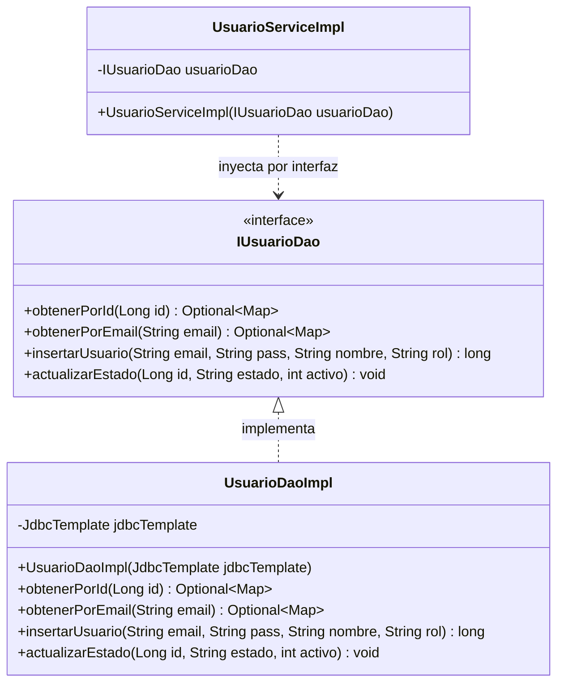
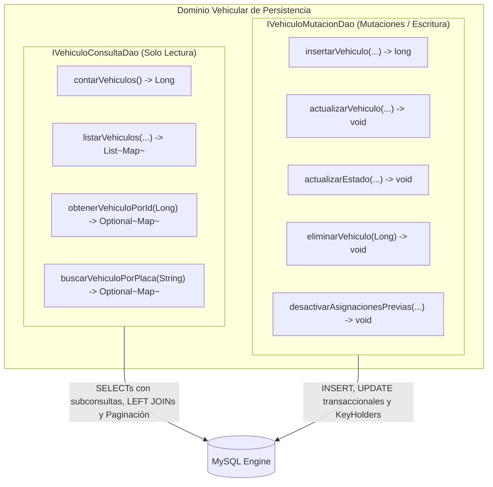

# Inmersión Técnica: Capa de Persistencia, Patrón DAO y Prevención de SQL Injection
### Documento Técnico de Referencia — Sistema TRANSIGOVAI (MTC Marcona)

Este documento detalla el diseño y la implementación de la capa de acceso a datos de **TRANSIGOVAI**, explicando el aislamiento arquitectónico del motor relacional MySQL mediante el patrón **DAO (Data Access Object)**, la política de blindaje contra inyección SQL con `JdbcTemplate` y la segregación de consultas y comandos (**CQRS**) en el dominio vehicular.

---

## 1. El Patrón DAO: Aislamiento e Inversión de Control

En arquitecturas empresariales de larga duración, la capa de lógica de negocio jamás debe interactuar directamente con librerías de conexión, drivers relacionales o sentencias SQL. 

TRANSIGOVAI implementa el patrón **DAO** segregando cada entidad en dos componentes:
1. **Contrato de Interfaz (`IDao` en `pe.marcona.mtc.dao`):** Define *qué* operaciones de persistencia existen sin revelar la tecnología subyacente.
2. **Implementación de Repositorio (`DaoImpl` en `pe.marcona.mtc.dao.impl`):** Ejecuta las sentencias SQL utilizando `JdbcTemplate` y gestiona las transacciones con MySQL.



### Beneficios Arquitectónicos:
* **Independencia del Motor de BD:** Si en el futuro se migra de MySQL 8 a PostgreSQL o una solución distribuida, únicamente se modifica la carpeta `dao/impl/`; la capa de negocio (`service/`) no sufre ni un solo cambio.
* **Pruebas Unitarias Aisladas (Unit Testing):** En `UsuarioServiceTest.java`, el DAO se simula con Mockito (`@Mock private IUsuarioDao usuarioDao`), permitiendo probar flujos de negocio sin depender de una base de datos encendida o datos volátiles.

---

## 2. Blindaje Absoluto Contra SQL Injection (JdbcTemplate Parametrizado)

La inyección de código SQL (SQLi) es una de las fallas de seguridad más destructivas en aplicaciones gubernamentales. En TRANSIGOVAI se erradicó por completo el uso de concatenación de cadenas (`"SELECT * FROM users WHERE email = '" + email + "'"`).

### El Estándar de Implementación Seguro:
Toda consulta dinámica utiliza marcadores de posición posicionales (`?`) asociados a un `PreparedStatement` nativo de JDBC.

#### Ejemplo Real 1: Búsqueda Unitaria Parametrizada (`PermisoDaoImpl.java`):

```java
@Repository
public class PermisoDaoImpl implements IPermisoDao {

    private final JdbcTemplate jdbcTemplate;

    public PermisoDaoImpl(JdbcTemplate jdbcTemplate) {
        this.jdbcTemplate = Preconditions.checkNotNull(jdbcTemplate);
    }

    @Override
    public Optional<Map<String, Object>> obtenerPorNumeroPermiso(String numeroPermiso) {
        // Bloque de texto inmutable con marcadores de posición '?'
        String sql = """
                SELECT p.id, p.numero_permiso, p.estado, p.fecha_emision, p.fecha_vencimiento,
                       p.qr_code, p.created_at,
                       v.placa, v.marca, v.modelo,
                       c.nombre AS company_nombre, c.ruc AS company_ruc
                FROM permits p
                LEFT JOIN vehicles v ON p.vehicle_id = v.id
                LEFT JOIN companies c ON p.company_id = c.id
                WHERE p.numero_permiso = ?
                """;

        // Parámetro vinculado a nivel de driver (escapado y sanitizado automáticamente)
        List<Map<String, Object>> resultados = jdbcTemplate.queryForList(sql, numeroPermiso);
        return resultados.isEmpty() ? Optional.empty() : Optional.of(resultados.get(0));
    }
}
```

#### Ejemplo Real 2: Inserción Transaccional con Generación de Llaves (`VehiculoMutacionDaoImpl.java`):

```java
@Override
public long insertarVehiculo(Long idEmpresa, String tipoPropiedad, String tipoServicio, String categoria,
                             String placa, String marca, String modelo, String color, Integer anioFabricacion,
                             String numeroVin, String numeroMotor, String combustible, String soatPoliza,
                             String soatAseguradora, LocalDate soatVencimiento, String rtEntidad,
                             String rtCertificado, LocalDate rtVencimiento) {
    String sql = """
            INSERT INTO vehicles (
                company_id, tipo_propiedad, tipo_servicio, categoria, placa, marca, modelo, color,
                ano_fabricacion, numero_vin, numero_motor, combustible,
                soat_poliza, soat_aseguradora, soat_vencimiento,
                rt_entidad, rt_certificado, rt_vencimiento, estado
            ) VALUES (?, ?, ?, ?, ?, ?, ?, ?, ?, ?, ?, ?, ?, ?, ?, ?, ?, ?, 'activo')
            """;

    KeyHolder keyHolder = new GeneratedKeyHolder();
    jdbcTemplate.update(connection -> {
        PreparedStatement ps = connection.prepareStatement(sql, Statement.RETURN_GENERATED_KEYS);
        // Mapeo seguro con control explícito de valores nulos y tipos SQL
        if (idEmpresa != null) ps.setLong(1, idEmpresa); else ps.setNull(1, java.sql.Types.BIGINT);
        ps.setString(2, tipoPropiedad);
        ps.setString(3, tipoServicio);
        ps.setString(4, categoria);
        ps.setString(5, placa.toUpperCase().trim());
        ps.setString(6, marca);
        ps.setString(7, modelo);
        ps.setString(8, color);
        if (anioFabricacion != null) ps.setInt(9, anioFabricacion); else ps.setNull(9, java.sql.Types.INTEGER);
        ps.setString(10, numeroVin);
        ps.setString(11, numeroMotor);
        ps.setString(12, combustible);
        ps.setString(13, soatPoliza);
        ps.setString(14, soatAseguradora);
        if (soatVencimiento != null) ps.setDate(15, Date.valueOf(soatVencimiento)); else ps.setNull(15, java.sql.Types.DATE);
        ps.setString(16, rtEntidad);
        ps.setString(17, rtCertificado);
        if (rtVencimiento != null) ps.setDate(18, Date.valueOf(rtVencimiento)); else ps.setNull(18, java.sql.Types.DATE);
        return ps;
    }, keyHolder);

    return keyHolder.getKey().longValue();
}
```

---

## 3. Segregación CQRS a Nivel de Acceso a Datos: `IVehiculoConsultaDao` vs `IVehiculoMutacionDao`

En el módulo automotor se adoptó la segregación de consultas y comandos (**CQRS**) separando la capa DAO en dos contratos complementarios pero independientes:



### ¿Por qué se separó en dos DAOs a nivel de Base de Datos?

1. **Optimización de Índices y Caché de Consultas:**
   * `VehiculoConsultaDaoImpl` ejecuta consultas con múltiples `LEFT JOIN` (hacia `vehicle_assignments`, `drivers`, `companies` y `vehicle_images`), agrupaciones y cláusulas `LIMIT` y `OFFSET`. Estas consultas se benefician de índices de cobertura en lectura (`idx_vehicles_placa_estado`).
   * `VehiculoMutacionDaoImpl` ejecuta escrituras atómicas que invalidan índices secundarios y deben minimizar el tiempo de bloqueo de fila (`row-level locking`).
2. **Seguridad de Transacciones:**
   * Los métodos de mutación deben ejecutarse dentro de fronteras transaccionales estrictas (`@Transactional(rollbackFor = Exception.class)`).
   * Los métodos de consulta son intrínsecamente de sólo lectura (`@Transactional(readOnly = true)`), lo que permite a Spring y al driver JDBC optimizar la gestión de conexiones y evitar la creación de buffers de rollback innecesarios.
3. **Escalabilidad Futura (Read Replicas):**
   * Esta división deja al sistema listo para que `VehiculoConsultaDaoImpl` apunte a una réplica de lectura de MySQL (Slave) y `VehiculoMutacionDaoImpl` apunte al nodo maestro (Master) simplemente configurando un enrutador de DataSources dinámico (`AbstractRoutingDataSource`), sin tocar una sola línea de lógica de negocio.
