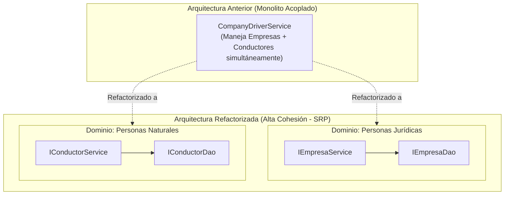

# Inmersión Técnica: Capa de Servicios, Principios SOLID y Programación Defensiva
### Documento Técnico de Referencia — Sistema TRANSIGOVAI (MTC Marcona)

Este documento detalla los principios de diseño orientados a objetos aplicados en la capa de servicios de **TRANSIGOVAI**, profundizando en la **Inversión de Dependencias (DIP)**, la **Segregación de Responsabilidades (SRP)** y la **Programación Defensiva (Fail-Fast)** con Google Guava.

---

## 1. Inversión de Dependencias (DIP): Desacoplamiento de Controladores y Servicios

El principio de Inversión de Dependencias establece:
1. *Los módulos de alto nivel no deben depender de módulos de bajo nivel. Ambos deben depender de abstracciones.*
2. *Las abstracciones no deben depender de los detalles. Los detalles deben depender de las abstracciones.*

### Implementación en los Controladores REST
En TRANSIGOVAI, ningún controlador conoce ni referencia clases con el sufijo `Impl`. Toda inyección se realiza a través de constructores tipados contra interfaces puras:

```java
package pe.marcona.mtc.controller;

import jakarta.servlet.http.HttpServletRequest;
import org.springframework.web.bind.annotation.*;
import pe.marcona.mtc.dto.ApiResponse;
import pe.marcona.mtc.service.IUsuarioService;
import com.google.common.base.Preconditions;

import java.util.Map;

/**
 * Adaptador de entrada REST. Depende exclusivamente del contrato IUsuarioService.
 */
@RestController
@RequestMapping("/api/users")
public class UsersController {

    private final IUsuarioService usuarioService;

    // Inyección de dependencias estricta por constructor (DIP)
    public UsersController(IUsuarioService usuarioService) {
        this.usuarioService = Preconditions.checkNotNull(
                usuarioService, "El servicio de usuarios no puede ser nulo");
    }

    @PostMapping("/create.php")
    public ApiResponse<Map<String, Object>> createUser(
            @RequestBody(required = false) Map<String, Object> body,
            HttpServletRequest request) {
        long id = usuarioService.crearUsuario(body, request);
        return ApiResponse.success(Map.of("id", id), "Usuario creado exitosamente");
    }

    @PostMapping("/update-status.php")
    public ApiResponse<Void> updateStatus(
            @RequestBody(required = false) Map<String, Object> body,
            HttpServletRequest request) {
        usuarioService.actualizarEstado(body, request);
        return ApiResponse.success(null, "Estado de usuario actualizado correctamente");
    }
}
```

### ¿Por qué esta práctica es superior a `@Autowired` sobre campos privados?
* **Inmutabilidad Garantizada (`final`):** Los campos inyectados por constructor son `final`, asegurando que no puedan ser reasignados tras la inicialización.
* **Cero Contenedor en Pruebas Unitarias:** Para probar `UsersControllerTest`, no se requiere levantar el contexto pesado de Spring (`ApplicationContext`); basta con instanciar el controlador directamente pasando un mock de Mockito: `new UsersController(mockUsuarioService)`.
* **Detección Temprana en Compilación:** Si falta una dependencia requerida, el compilador de Java detecta el error antes de ejecutar el servidor.

---

## 2. Segregación de Responsabilidades (SRP): Desacoplamiento de Empresas y Conductores

El principio de Responsabilidad Única (SRP) enuncia que *una clase debe tener una, y solo una, razón para cambiar*.

### La Violación Arquitectónica Previa:
Originalmente, el sistema contaba con una clase monolítica llamada `CompanyDriverService` que concentraba simultáneamente:
* Validación de RUC y razones sociales de personas jurídicas.
* Control de licencias MTC, récords de conductor y exámenes médicos de personas naturales.
* Gestión de flotas y relaciones laborales.

Cualquier cambio en la normativa de licencias de conducir obligaba a modificar el mismo archivo donde se gestionaba la razón social de las empresas de transporte, aumentando el riesgo de regresiones y conflictos de integración.

### La Solución Implementada: Segregación Cohesiva



### Integración Limpia en el Controlador Adaptador (`CompanyDriverController.java`):

Cuando el cliente HTTP requiere operar sobre ambos dominios, el controlador actúa como un orquestador que inyecta ambos contratos de forma segregada:

```java
@RestController
@RequestMapping("/api")
public class CompanyDriverController {

    private final IEmpresaService empresaService;
    private final IConductorService conductorService;
    private final IAutenticacionService autenticacionService;

    // Segregación limpia: Cada servicio atiende exclusivamente su área de incumbencia
    public CompanyDriverController(
            IEmpresaService empresaService,
            IConductorService conductorService,
            IAutenticacionService autenticacionService) {
        this.empresaService = Preconditions.checkNotNull(empresaService);
        this.conductorService = Preconditions.checkNotNull(conductorService);
        this.autenticacionService = Preconditions.checkNotNull(autenticacionService);
    }

    @GetMapping("/companies/list.php")
    public ApiResponse<Map<String, Object>> listCompanies(
            @RequestParam Map<String, String> query, HttpServletRequest request) {
        autenticacionService.requerirUsuarioEnRoles(request, Set.of("admin", "operador"));
        return ApiResponse.success(empresaService.listarEmpresas(query), null);
    }

    @GetMapping("/drivers/list.php")
    public ApiResponse<Map<String, Object>> listDrivers(
            @RequestParam Map<String, String> query, HttpServletRequest request) {
        autenticacionService.requerirUsuarioEnRoles(request, Set.of("admin", "operador", "fiscalizador"));
        return ApiResponse.success(conductorService.listarConductores(query), null);
    }
}
```

---

## 3. Programación Defensiva (Principio Fail-Fast con Google Guava)

En software robusto, los errores deben interceptarse en el punto más cercano a su origen antes de que contaminen capas inferiores. Si un dato inválido o una referencia nula atraviesa la capa de servicios, provocará excepciones confusas en tiempo de ejecución (`NullPointerException`) o fallas de integridad en la base de datos relacional.

TRANSIGOVAI utiliza la librería **Google Guava** (`com.google.common.base.Preconditions`) como estándar obligatorio para la validación defensiva al inicio de cada método.

### 1. `Preconditions.checkNotNull`: Integridad de Dependencias y Parámetros

```java
@Service
public class AsignacionServiceImpl implements IAsignacionService {

    private final IAsignacionDao asignacionDao;
    private final IAuditoriaService auditoriaService;

    public AsignacionServiceImpl(IAsignacionDao asignacionDao, IAuditoriaService auditoriaService) {
        // Falla inmediatamente si Spring o un test unitario no suministra el DAO requerido
        this.asignacionDao = Preconditions.checkNotNull(asignacionDao, 
                "El DAO de asignaciones no puede ser nulo");
        this.auditoriaService = Preconditions.checkNotNull(auditoriaService, 
                "El servicio de auditoría no puede ser nulo");
    }
}
```

### 2. `Preconditions.checkArgument`: Reglas de Invarianza de Negocio

```java
@Service
public class VehiculoMutacionServiceImpl implements IVehiculoMutacionService {

    @Override
    public long registrarVehiculo(Map<String, Object> payload, HttpServletRequest request) {
        String placa = texto(payload, "placa");
        
        // Validación Fail-Fast: Si la placa no cumple el estándar peruano, se aborta la ejecución
        Preconditions.checkArgument(!placa.isBlank(), "La placa vehicular no puede estar vacía");
        Preconditions.checkArgument(placa.matches("^[A-Z0-9]{6,7}$"), 
                "El formato de placa vehicular [%s] es inválido para el estándar MTC", placa);

        // Validación de no duplicidad antes de tocar operaciones pesadas de base de datos
        if (vehiculoMutacionDao.existePlaca(placa, null)) {
            throw new ApiException(HttpStatus.CONFLICT, "Ya existe un vehículo registrado con la placa: " + placa);
        }

        // Proceder de forma segura hacia la persistencia...
        return vehiculoMutacionDao.insertarVehiculo(...);
    }
}
```

### Resumen de Beneficios:
1. **Mensajes de Error Ricos en Contexto:** Los mensajes incluyen los valores infractores (`[%s]`), facilitando el diagnóstico inmediato en los logs.
2. **Cero Datos Corruptos en Base de Datos:** Los DAOs y MySQL reciben exclusivamente información sanitizada y verificada.
3. **Claridad Semántica:** El código se documenta a sí mismo mediante precondiciones explícitas, haciendo evidente para cualquier nuevo desarrollador cuáles son los requisitos de entrada de cada función.
