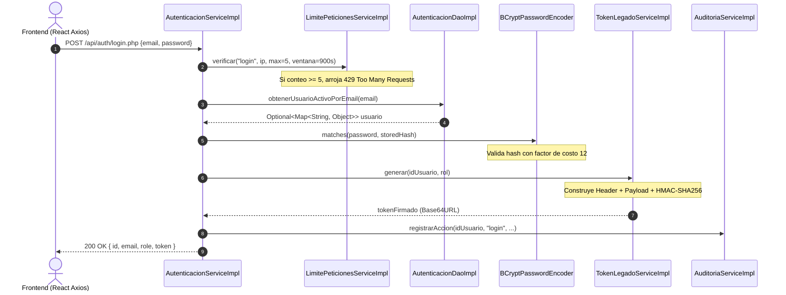

# Inmersión Técnica: Arquitectura de Seguridad, Criptografía y Ciclo de Vida del JWT
### Documento Técnico de Referencia — Sistema TRANSIGOVAI (MTC Marcona)

Este documento detalla la arquitectura de seguridad del backend de **TRANSIGOVAI**, explicando con código real y análisis matemático los mecanismos de derivación de claves (BCrypt), la generación y firma criptográfica de tokens JWT (HMAC-SHA256) y el esquema de inspección perimetral de peticiones mediante el método de intercepción `requerirUsuario` / `requerirUsuarioEnRoles`.

---

## 1. Hash de Contraseñas con BCrypt (Factor de Trabajo: Costo 12)

La protección de credenciales descansa sobre el algoritmo de derivación de claves **BCrypt** implementado a través de `org.springframework.security.crypto.bcrypt.BCryptPasswordEncoder`.

### Justificación Criptográfica del Costo 12
BCrypt incorpora una función de hashing basada en el cifrado Blowfish con una clave calculada mediante un costo exponencial ($2^{\text{costo}}$ iteraciones). En TRANSIGOVAI se configuró explícitamente un factor de trabajo de **12**:

$$\text{Iteraciones} = 2^{12} = 4096 \text{ rondas de expansión de clave}$$

Este factor asegura que cada cálculo de verificación demore aproximadamente entre 250 y 350 milisegundos en CPU moderna, logrando:
* Neutralización completa de ataques de diccionario y fuerza bruta masiva mediante GPUs o ASICs dedicados.
* Mitigación de Rainbow Tables gracias a la generación de un *salt* criptográficamente aleatorio de 128 bits (16 bytes) embebido en cada hash generado.

### Implementación en Código (`UsuarioServiceImpl.java` y `AutenticacionServiceImpl.java`):

```java
@Service
public class UsuarioServiceImpl implements IUsuarioService {

    // Instanciación estricta con factor de trabajo 12
    private final BCryptPasswordEncoder passwordEncoder = new BCryptPasswordEncoder(12);

    @Override
    public long crearUsuario(Map<String, Object> datos, HttpServletRequest solicitud) {
        String rawPassword = texto(datos, "password");
        
        // Validación defensiva previa de longitud y complejidad
        if (rawPassword.length() < 6) {
            throw new ApiException(HttpStatus.BAD_REQUEST, "La contraseña debe tener al menos 6 caracteres");
        }

        // Generación de hash no reversible con salt aleatorio
        String hashedPassword = passwordEncoder.encode(rawPassword);

        // Envío seguro a la capa DAO (nunca viaja en texto plano)
        return usuarioDao.insertarUsuario(email, hashedPassword, nombre, role);
    }
}
```

```java
// Verificación en tiempo de autenticación (AutenticacionServiceImpl.java)
if (!passwordEncoder.matches(password, String.valueOf(usuario.get("password")))) {
    long idUsuario = ((Number) usuario.get("id")).longValue();
    auditoriaService.registrarAccion(idUsuario, "login_intento", "usuario", idUsuario,
            "Intento fallido de login", solicitud);
    throw new ApiException(HttpStatus.UNAUTHORIZED, "Email o contraseña incorrectos");
}
```

---

## 2. Ciclo de Vida del JWT en `IAutenticacionService.iniciarSesion()`

El proceso de emisión de tokens de autenticación desacoplados sigue un protocolo estricto donde intervienen la validación de peticiones, el control de saturación (Rate Limiting), la verificación en base de datos y la firma simétrica.



### Anatomía y Firma del Token (`TokenLegadoServiceImpl.java`)

El token consta de tres segmentos separados por puntos (`.`): `Header.Payload.Signature`.

```java
@Override
public String generar(long idUsuario, String rol) {
    try {
        // 1. Cabecera (Header): Declaración del algoritmo y tipo
        String cabecera = codificar(Map.of("alg", "HS256", "typ", ""));

        // 2. Carga Útil (Payload / Claims): Metadatos de autorización y expiración
        var reclamos = new LinkedHashMap<String, Object>();
        reclamos.put("user_id", idUsuario);
        reclamos.put("role", rol);
        reclamos.put("iat", Instant.now().getEpochSecond()); // Issued At
        reclamos.put("exp", Instant.now().getEpochSecond() + segundosExpiracion); // Expiración (86400s = 24h)

        String cuerpo = codificar(reclamos);
        String contenido = cabecera + "." + cuerpo;

        // 3. Firma Criptográfica (Signature): HMAC-SHA256(secreto, contenido)
        String firma = CODIFICADOR.encodeToString(firmar(contenido));

        return contenido + "." + firma;
    } catch (JsonProcessingException | GeneralSecurityException ex) {
        throw new IllegalStateException("No se pudo generar el token de sesión.", ex);
    }
}
```

### Prevención de Timing Attacks en la Verificación
En `TokenLegadoServiceImpl.verificar(token)`, la comparación de la firma recibida contra la firma recalculada **no** utiliza `Arrays.equals` ni `String.equals` (los cuales terminan anticipadamente en el primer byte diferente y exponen vulnerabilidades de canal lateral / timing attacks). En su lugar, se emplea `MessageDigest.isEqual`:

```java
byte[] firmaRecibida = DECODIFICADOR.decode(partes[2]);
byte[] firmaEsperada = firmar(partes[0] + "." + partes[1]);

// Comparación en TIEMPO CONSTANTE: Previene ataques de análisis de tiempo
if (!MessageDigest.isEqual(firmaEsperada, firmaRecibida)) {
    return null;
}
```

---

## 3. El Guardián: Método de Intercepción `requerirUsuarioEnRoles()`

La autorización de peticiones se ejecuta mediante el método `requerirUsuarioEnRoles` en `AutenticacionServiceImpl`. Este método actúa como la compuerta perimetral para cualquier controlador o servicio que requiera privilegios.

### Código Fuente de Inspección (`AutenticacionServiceImpl.java`):

```java
@Override
public Map<String, Object> requerirUsuarioEnRoles(HttpServletRequest solicitud, Set<String> rolesRequeridos) {
    // 1. Extracción con soporte dual: Header Authorization (Bearer) o X-Auth-Token
    String authorization = solicitud.getHeader("Authorization");
    String token;
    if (authorization != null) {
        token = authorization.matches("(?i)^Bearer\\s+.+$")
                ? authorization.replaceFirst("(?i)^Bearer\\s+", "").trim()
                : null;
    } else {
        token = solicitud.getHeader("X-Auth-Token");
    }

    if (token == null || token.isBlank()) {
        throw new ApiException(HttpStatus.UNAUTHORIZED, "Token no proporcionado");
    }

    // 2. Validación de firma criptográfica y expiración matemática
    Map<String, Object> claims = tokenLegadoService.verificar(token);
    if (claims == null) {
        throw new ApiException(HttpStatus.UNAUTHORIZED, "Token inválido o expirado");
    }

    // 3. Extracción y normalización de la identidad del usuario
    Object userIdClaim = claims.get("user_id");
    long idUsuario = userIdClaim instanceof Number number
            ? number.longValue()
            : Long.parseLong((String) userIdClaim);

    // 4. Doble Verificación contra la Base de Datos (Revocación Inmediata)
    Optional<Map<String, Object>> usuarioOpt = autenticacionDao.obtenerUsuarioPorId(idUsuario);
    if (usuarioOpt.isEmpty()) {
        throw new ApiException(HttpStatus.UNAUTHORIZED, "Usuario inválido o inactivo");
    }

    Map<String, Object> usuario = usuarioOpt.get();

    // 5. Comprobación de estado operativo del usuario
    if ("inactivo".equals(usuario.get("estado")) || !esActivo(usuario.get("is_active"))) {
        throw new ApiException(HttpStatus.UNAUTHORIZED, "Usuario inválido o inactivo");
    }

    // 6. Control de Acceso Basado en Roles (RBAC)
    if (!rolesRequeridos.isEmpty() && !rolesRequeridos.contains(usuario.get("role"))) {
        throw new ApiException(HttpStatus.FORBIDDEN, "No tiene permisos para esta acción");
    }

    return usuario;
}
```

### Ventaja de la Doble Verificación en Base de Datos:
A diferencia de los esquemas JWT puramente *stateless* que no pueden revocar accesos hasta que el token expire naturalmente, TRANSIGOVAI consulta el estado `is_active` en la base de datos MySQL. Si un administrador desactiva a un inspector en el panel, el token del inspector queda invalidado **en la siguiente petición de inmediato**.

